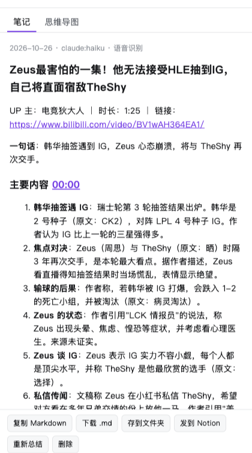
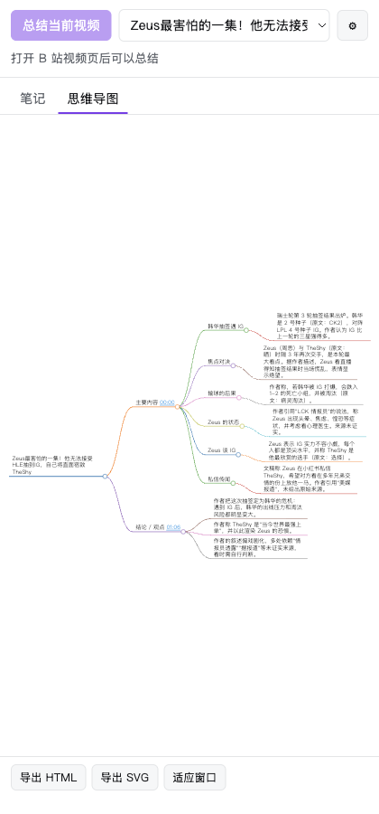
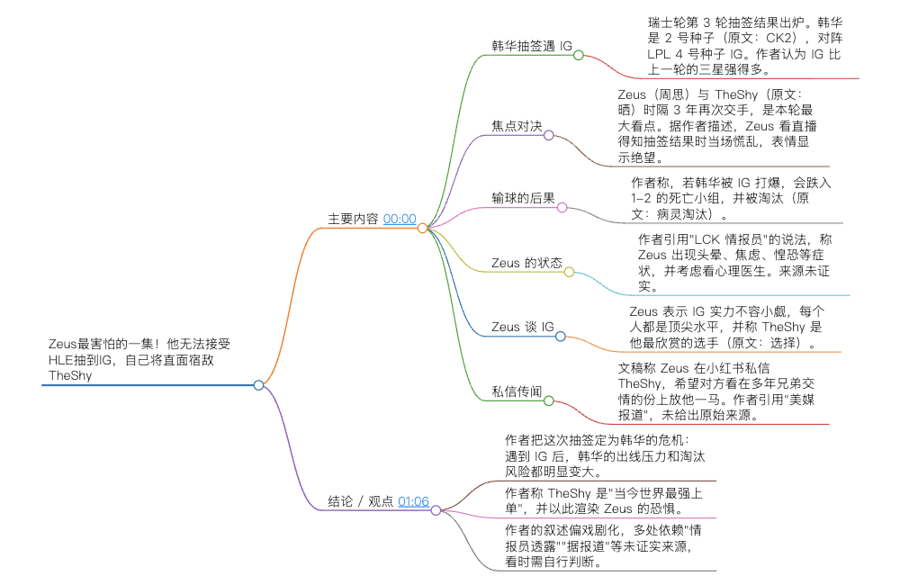

# bili-obsidian

在 B 站视频页点一下按钮，把视频总结成笔记。模型可以用本机的 Claude Code、Codex、opencode 等 agent 命令行，也可以用 DeepSeek、通义千问、Kimi 等各家 API。笔记可以存进 Obsidian 等本地笔记库，也可以下载成 Markdown、发到 Notion，或画成思维导图。视频没有 AI 字幕时，自动下载音频在本机转成文字再总结。支持 macOS 和 Windows 上的 Chrome、Edge、Brave。

**Bilibili video summary in one click — local agent CLIs or any OpenAI-compatible API; export to Obsidian, Notion, Markdown and mind maps.**

 

## 功能清单

**总结**
- [x] 视频页右下角一个按钮，点一下完成：取字幕 → 总结 → 自动导出
- [x] 优先用 B 站 AI 字幕；没有字幕时下载音频，在本机用 faster-whisper 转写，音频不上传
- [x] 按钮实时显示进度，转写时显示百分比
- [x] 分P视频每一P单独总结
- [x] 侧边栏：预览笔记、切换历史笔记（保留最近 50 条）、重新总结

**模型**
- [x] 本机 agent 命令行，用它们已登录的账号：Claude Code、Codex、opencode、Gemini CLI、Qwen Code
- [x] 自定义命令：任何能从标准输入读提示词、往标准输出写结果的命令行（如 kimi、cursor-agent）
- [x] API（OpenAI 兼容接口）：DeepSeek、通义千问、Kimi、智谱 GLM、豆包、硅基流动、OpenAI、Anthropic、Gemini、OpenRouter、Ollama、LM Studio，或任意自定义地址
- [x] 一键读取 API 的模型列表；测试连接

**笔记**
- [x] 8 种风格：标准、精简、详细、教程、学术、会议纪要、小红书、问答卡片
- [x] 原片跳转：每节标题后带时间，点击跳到视频对应位置
- [x] 目录、附上文字稿（折叠）可选
- [x] frontmatter 带标题、标签、UP 主、链接、封面、时长、日期、来源、模型，可直接用 Dataview 检索
- [x] 附加要求：写给模型的额外指令

**导出**
- [x] 本地文件夹：Obsidian、Logseq、思源等的库都是文件夹；可选保存后在 Obsidian 里打开
- [x] Markdown：下载 .md、复制到剪贴板（语雀、飞书文档等能直接粘贴 Markdown）
- [x] Notion：写进指定数据库，标题、链接、标签、日期自动填进对应属性，封面用视频封面
- [x] 思维导图：侧边栏查看，导出 HTML（离线可打开、可缩放）或 SVG
- [x] 每种方式都能设为总结完自动执行

**安装**
- [x] 一行命令安装和更新
- [x] 本地服务不常驻后台：浏览器扩展需要时才启动它，用完就退出，不监听端口

**暂不支持**
- [ ] 上架 Chrome 应用商店（目前要用开发者模式加载扩展）
- [ ] 番剧、电影、课程页（只支持 `bilibili.com/video/` 页面）
- [ ] 大会员专享或付费视频的音频转写（下载音频不带登录状态）
- [ ] 收藏夹、合集批量总结
- [ ] Linux、Firefox、Safari

## 工作原理

```
B 站视频页（扩展的悬浮按钮）── 字幕地址，或「没有字幕」──▶ 扩展后台
                                                              │
     ┌─────────────── 用 API 时 ─────────────────────────────┤
     ▼                                                        ▼ Native Messaging（浏览器按需启动）
DeepSeek / 通义 / Kimi / OpenAI …                    本地服务 host/bili_host.py
                                                      ├─ claude / codex / opencode / gemini / qwen
                                                      ├─ 音频转写 asr.py（faster-whisper）
                                                      └─ 写入本地文件夹
     │                                                        │
     └──────────────▶ 笔记 ──▶ 侧边栏 · Markdown · Notion · 思维导图
```

- **浏览器扩展**（`extension/`）：页面上的按钮、侧边栏、设置页。直接调用 API 模型和 Notion。
- **本地服务**（`host/`）：只做浏览器做不了的事：运行本机命令行、转写音频、写本地文件。浏览器只允许这个扩展启动它；扩展只能让它运行写死在代码里的几个命令行（和你在设置里填的自定义命令）。
- **隐私**：字幕或转写出的文字稿会发给你选的模型。API Key 只存在本机浏览器里，不同步到浏览器账号。
- **防提示词注入**：字幕和简介由视频作者控制，可能藏着要 agent 读文件、跑命令的话。提示词把它们标成「只是材料」；Claude Code 关掉全部工具运行；opencode 用拒绝全部权限的配置运行；Codex 关不掉读文件，只能在只读沙盒里运行（不能写文件、不能联网）；Gemini CLI、Qwen Code 和自定义命令不做限制。总结来路不明的视频，优先用 Claude Code、opencode 或 API。

只用 API 模型、只总结有字幕的视频时，可以不装本地服务。

## 准备

- Chrome、Edge 或 Brave
- 浏览器里登录 B 站：AI 字幕只对登录用户可见。没登录也能用，但每个视频都要走更慢的音频转写
- 用本地命令行时，至少装一个并登录过：[Claude Code](https://docs.claude.com/claude-code)、[Codex](https://github.com/openai/codex)、[opencode](https://opencode.ai)、[Gemini CLI](https://github.com/google-gemini/gemini-cli)、[Qwen Code](https://github.com/QwenLM/qwen-code)
- 用 API 时，准备好对应平台的 API Key
- Python 3.8+：macOS 装了 Xcode 命令行工具就有；Windows 到 python.org 下载，安装时勾选 Add to PATH
- 约 1GB 磁盘空间给音频转写（faster-whisper 约 200MB，small 模型约 500MB）

## 安装

### 1. 装本地服务

**macOS**（终端里运行）：

```bash
curl -fsSL https://raw.githubusercontent.com/leinaldo/bili-obsidian/main/get.sh | bash
```

**Windows**（PowerShell 里运行）：

```powershell
irm https://raw.githubusercontent.com/leinaldo/bili-obsidian/main/get.ps1 | iex
```

命令把代码下载到 `~/tools/bili-obsidian`（可用环境变量 `BILI_OBSIDIAN_DIR` 改位置），然后：

1. 安装音频转写组件。
2. 在你的终端环境里查找 agent 命令行，记下完整路径。浏览器启动本地服务时找不到 nvm、Homebrew 里装的命令，所以要提前记下。
3. 给本机的 Chrome、Edge、Brave 等浏览器注册本地服务，并启动一次自检。
4. 把扩展文件夹的路径复制到剪贴板。

装了新的命令行（比如后来装了 Codex），重新运行一次安装命令，让它记下路径。

### 2. 加载浏览器扩展

1. 打开扩展管理页：Chrome 是 `chrome://extensions`，Edge 是 `edge://extensions`。
2. 打开「开发者模式」。
3. 点「加载已解压的扩展程序」，选择安装目录里的 `extension` 文件夹。macOS 上可以在选择窗口里按 Cmd+Shift+G 粘贴路径。
4. 浏览器之前开着的话，完全退出再打开一次，让它读到本地服务。

扩展装好后会打开设置页，「本地服务」一栏显示「✓ 已连接」就说明两边接通了。

### 更新

再运行一次安装命令，然后在扩展管理页点这个扩展的「重新加载」按钮。设置、历史笔记、转写模型都会保留。

### 从旧版本（油猴脚本）升级

安装命令会自动停掉旧版本的后台服务。你要手动在 Tampermonkey 里删掉「B站总结到 Obsidian」脚本。旧版本的设置不会迁移，在扩展的设置页里重新选一下模型和 Obsidian 库。

## 使用

- **页面按钮**：在视频页点右下角的「总结视频」。按钮显示进度，完成后点它打开侧边栏看笔记。按钮可以拖动，位置会记住。
- **侧边栏**：点浏览器工具栏上的扩展图标打开。可以总结当前视频、切换历史笔记、手动导出、看思维导图。
- **设置**：点按钮旁的 ⚙，或在侧边栏里点 ⚙。

| 情况 | 按钮显示 | 耗时 |
|---|---|---|
| 有 AI 字幕 | 获取字幕 → 下载字幕 → 正在总结 → ✓ 已完成 | 主要看模型，一般十几秒到一分钟 |
| 没有 AI 字幕 | 无字幕，下载音频 → 无字幕，转写音频 42% → 正在总结 → ✓ 已完成 | 转写约占视频时长的 1/5（M4 Pro 实测：12 分钟视频约 2.5 分钟）；第一次还要下载模型 |



## 设置说明

### 模型

- **本地命令行**：本地服务检测到的命令行会列出来，选一个，再填模型名（下拉里有能读到的模型）。
  - Claude Code：`sonnet`、`opus`、`haiku`
  - Codex：用 ChatGPT 账号登录时要填账号支持的模型名
  - opencode：`provider/model` 格式，例如 `deepseek/deepseek-flash`
  - Gemini CLI、Qwen Code：按官方文档的无头模式调用，作者没有实测
- **自定义命令**：比如 `kimi --print`。提示词从标准输入传给命令，命令的标准输出就是笔记。
- **API**：选平台点「添加」，填 API Key，点「测试」。第一次测试时浏览器会问是否允许访问这个网址，要点允许。

### 导出

| 方式 | 说明 |
|---|---|
| 本地文件夹 | 填完整路径，或点「选择…」，或点检测到的 Obsidian 库（自动用库里的「B站总结」文件夹）。同一个视频再总结会覆盖原来的文件 |
| Markdown | 下载到浏览器的「下载/B站总结」，或在侧边栏复制 |
| Notion | 在 [Notion 集成页](https://www.notion.so/profile/integrations) 新建内部集成拿到密钥；在数据库页右上角「⋯ → 连接」里加上这个集成；把密钥和数据库网址填进设置。数据库的标题、第一个网址属性、第一个多选属性、第一个日期属性，分别填视频标题、链接、标签、日期；名字里带「UP」「作者」的文本属性填 UP 主 |
| 思维导图 | 在侧边栏查看和导出 |

### 音频转写

可选 `small`（默认）、`medium`、`large-v3-turbo`。模型越大越准，也越慢、越占磁盘。第一次用某个模型时从 ModelScope 下载，连不上再试 Hugging Face。

## 常见问题

| 现象 | 原因 / 解决 |
|---|---|
| 设置页显示「没装本地服务」 | 运行安装命令，然后完全退出浏览器再打开 |
| 视频页没有按钮 | 扩展没加载，或加载后没刷新视频页 |
| 点按钮打不开侧边栏 | 点浏览器工具栏上的扩展图标打开 |
| 设置里没列出某个命令行 | 装好后重新运行安装命令，让它记下路径 |
| claude 失败：Not logged in | 在终端里运行 `claude`，输入 `/login` |
| codex 失败：model is not supported | 在设置里换一个你的账号支持的模型名 |
| 连不上某个 API | 检查接口地址；在设置里点这个 API 的「测试」，并允许访问网址 |
| Notion 报错 object not found | 数据库还没「连接」你的集成 |
| 有字幕的视频也显示「无字幕，…」 | 浏览器没登录 B 站，或字幕没加载出来。登录后刷新视频页再点 |
| 音频转写失败 | 看安装目录里的 `host.log`。模型下载失败多半是网络问题，再点一次会重新下载 |

## 开发

- 改完 `extension/` 里的代码，在扩展管理页点「重新加载」。
- 纯逻辑自检：`node extension/test/check.mjs`
- 内置的第三方库在 `extension/vendor/`：marked 18.0.14（MIT）、markmap-view 0.18.12（MIT）、d3 7.9.0（ISC）。扩展不能加载远程代码，所以随扩展一起发布。
- 扩展 ID 固定为 `kcoaeghgmnflfeonjdpodfeakekcofga`，由 `manifest.json` 里的 `key` 决定；本地服务只允许这个 ID 连接。

## 卸载

macOS 运行 `./uninstall.sh`，Windows 双击 `uninstall.cmd`，取消本地服务的注册。然后在扩展管理页移除扩展。想释放磁盘空间，删掉安装目录。已生成的笔记不会删除。
