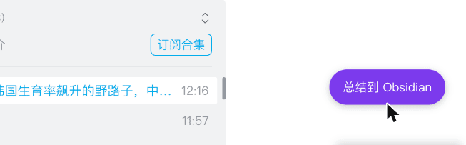
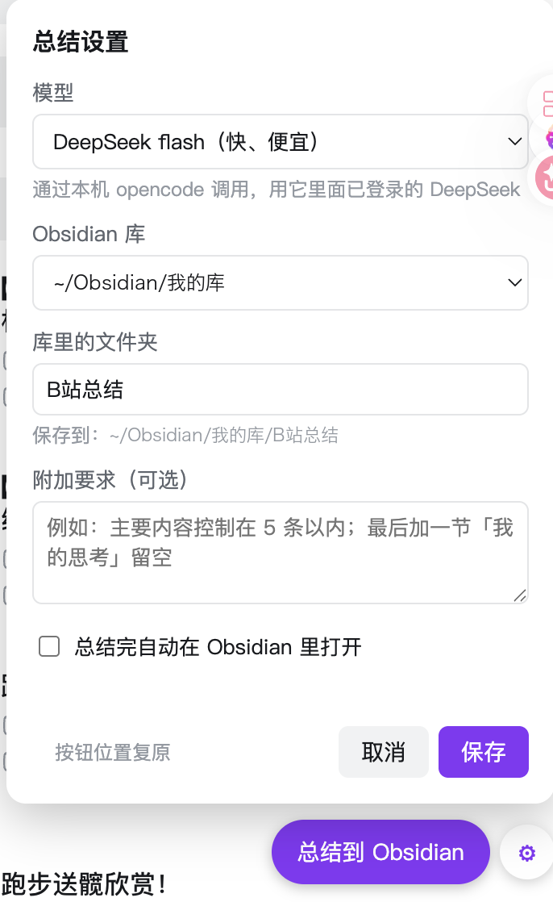

# bili-obsidian

在 B 站视频页点一下按钮，就能用 Claude 或 DeepSeek 把视频总结成笔记，存进 Obsidian。视频没有 AI 字幕时，自动下载音频在本机转成文字再总结。支持 macOS 和 Windows。



生成的笔记长这样（节选）：

```markdown
---
tags: [B站总结, 人口, 生育率, 韩国, 日本, 生育补贴, 跨国婚姻]
up: "CLS同学"
url: https://www.bilibili.com/video/BV1NvJ66gEMn/
duration: "12:16"
date: 2026-10-23
---

# 【深度】一个让韩国生育率飙升的野路子，中国该学吗？

UP 主：CLS同学 ｜ 时长：12:16 ｜ 链接：https://www.bilibili.com/video/BV1NvJ66gEMn/

**一句话**：解析2026年日韩出生人口反弹的原因，并探讨我国能借鉴哪些做法。

## 主要内容
1. **日韩出生人口双双回升**：韩国2026年6月出生2.31万人，同比增15.6%……
2. **加大生育补贴**：……
（共 7 条）

## 结论 / 观点
- ……
```

```
B 站视频页（油猴按钮）──字幕地址──▶ 本地服务 127.0.0.1:17321 ──▶ claude -p ──▶ Obsidian/B站总结/<标题>.md
```

- **油猴脚本**（`bili-summary.user.js`）：借你已登录的页面加载 AI 字幕，把字幕地址发给本地服务。拿不到字幕时不带地址。不读 cookie。
- **本地服务**（`server.py`）：下载字幕，调用 Claude Code 命令行写总结，写进 Obsidian，完成后弹系统通知。只监听本机。
- **音频转写**（`asr.py`）：没有字幕时，本地服务用它下载音频，用 [faster-whisper](https://github.com/SYSTRAN/faster-whisper) 在本机转成文字稿。不上传音频。

## 准备

- 下面两个至少装一个，用来写总结：
  - [Claude Code](https://docs.claude.com/claude-code)：在终端里运行过一次 `claude` 完成登录
  - [opencode](https://opencode.ai)（用 DeepSeek）：运行 `opencode auth login` 选 DeepSeek 并登录。不需要在本工具里填 API Key
- Python 3.8+（macOS 装了 Xcode 命令行工具就有；Windows 到 python.org 下载，安装时勾选 Add to PATH）
- 浏览器里装好 [Tampermonkey](https://www.tampermonkey.net/)
- B 站账号已登录（AI 字幕只对登录用户可见；没登录也能用，但会走更慢的音频转写）
- 约 1GB 磁盘空间给音频转写：安装脚本把 faster-whisper 装进 `asr-venv/`（约 200MB）；第一次转写时从 ModelScope 下载模型到 `models/`（small 约 500MB），连不上再试 Hugging Face

## 安装

### 一行命令（推荐）

不用克隆仓库，复制一行命令运行即可。它会把代码下载到 `~/tools/bili-obsidian`，再运行安装脚本。

**macOS**（终端里运行）：

```bash
curl -fsSL https://raw.githubusercontent.com/leinaldo/bili-obsidian/main/get.sh | bash
```

**Windows**（PowerShell 里运行）：

```powershell
irm https://raw.githubusercontent.com/leinaldo/bili-obsidian/main/get.ps1 | iex
```

**更新**：再运行一次同样的命令就行。你的设置（`config.json`）会保留，油猴脚本会自动拉新版。

- 想换安装位置：先设环境变量 `BILI_OBSIDIAN_DIR`
- macOS 给安装脚本传参数：`curl … | bash -s -- --vault ~/my-vault`
- 更新时不想弹浏览器：先设环境变量 `BILI_OBSIDIAN_NO_BROWSER=1`

### 让 AI 帮你装

把下面这段话贴到 Claude Code、opencode 这类能在你电脑上执行命令的 AI 对话框里：

```text
帮我安装 https://github.com/leinaldo/bili-obsidian 。
先按 README 的「准备」检查环境，缺什么告诉我；
然后用 README 里「一行命令」的方式安装，
最后告诉我还需要我手动点哪里。
```

### 手动安装

先把仓库克隆或下载到本地，然后：

**macOS**

```bash
./install.sh
```

**Windows**：双击 `install.cmd`。

安装脚本会从 Obsidian 的配置里找库：只有一个就直接用，多个会让你选。也可以直接指定：

```bash
./install.sh --vault ~/my-vault --folder B站总结 --model sonnet
```

服务起来后，安装脚本会接着处理油猴脚本：

1. 检查 Chrome / Edge / Brave 里有没有装 Tampermonkey，没有就打开扩展商店，装好后回终端按回车。
2. 在你看 B 站用的浏览器里打开两个页面。只有一个浏览器装了 Tampermonkey 就用它；Chrome、Edge 等好几个都装了的话，会问你用哪个（默认是系统默认浏览器），选过会记在 `config.json` 里，下次不再问。想换浏览器，设环境变量 `BILI_OBSIDIAN_BROWSER=chrome`（或 `edge`、`brave`）再运行一次安装。
   **下面两下要你自己点**（浏览器不允许程序替你点）：
   - **Tampermonkey 安装页**：点「安装」。没弹出的话手动打开 `http://127.0.0.1:17321/bili-summary.user.js`
   - **Tampermonkey 扩展详情页**：打开「**允许用户脚本**」开关。新版 Chrome 默认关着，不开的话脚本装上了也不会运行。
     安装脚本会先只读检查这个开关：已经开了就跳过；没开就带你去这一页，并在终端里等你打开（最多 3 分钟），检测到后提示「✓ 已开启」。
     macOS 上会直接打开这一页。Windows 上浏览器不允许外部程序打开 `chrome://` 地址，安装脚本会把地址复制到剪贴板，你在地址栏粘贴回车即可。
     这个开关只能你自己点，程序改不了（浏览器把它存在带签名的配置文件里）
3. **刷新** B 站视频页，右下角会出现紫色按钮「总结到 Obsidian」。

之后油猴脚本有更新（比如重新运行一行命令或 `git pull` 之后），Tampermonkey 会按 `@updateURL` 从本地服务自动拉新版，不用再手动装。

油猴脚本每次在 B 站页面运行时，会向本地服务报一下自己的版本。再次运行安装命令时，如果它已经是最新版，就不会再打开脚本安装页和扩展详情页。

按钮不出现的话，多半是「允许用户脚本」没开：打开 `chrome://extensions`（Edge 是 `edge://extensions`），进 Tampermonkey 的「详细信息」打开它，再刷新 B 站。

## 使用

点按钮后，按钮上会依次显示：获取字幕 → 下载字幕 → Claude（或 DeepSeek）正在总结 → ✓ 已存入 Obsidian。用 Sonnet 或 DeepSeek Flash 一般十几到二十秒。

- **按钮可以拖动**：按住拖到任意位置，位置会记住。被别的扩展挡住时很有用。
- **点按钮旁的 ⚙ 打开设置面板**，可以改：
  - 模型：Sonnet / Opus / Haiku（走 claude 命令行），DeepSeek（走 opencode，列表实时读自本机 opencode，目前是 flash 和 v4-pro），或自定义模型名
  - Obsidian 库（列出本机所有库）和库里的文件夹，下方实时显示完整保存路径
  - 附加要求：会加进给模型的指令里，比如「主要内容控制在 5 条以内」
  - 总结完是否自动在 Obsidian 里打开这篇笔记

  

  设置存在本地服务的 `config.json` 里，保存后下次点总结就生效，不用重启服务。
- 分P视频每一P单独点，笔记标题后面带「P几」。
- 同一个视频再点一次，会覆盖原来那篇笔记。
- 视频没有 AI 字幕时，按钮会显示：无字幕，下载音频 → 无字幕，转写音频 xx% → 正在总结。转写速度约为视频时长的 1/5（M4 Pro 实测：12 分钟视频转写约 2.5 分钟），第一次还要先下载模型。

## 配置

日常用设置面板改就行。`config.json` 由安装脚本生成，也可以手动改，改完重新运行安装脚本让服务重启：

| 字段 | 说明 | 默认 |
|---|---|---|
| `vault` | Obsidian 库路径 | 从 Obsidian 配置里读 |
| `folder` | 库里存总结的文件夹 | `B站总结` |
| `model` | 模型名。`deepseek` 开头或 `provider/model` 格式的交给 opencode，其余交给 claude | `sonnet` |
| `extra_prompt` | 附加要求 | 空 |
| `open_after` | 总结完自动在 Obsidian 里打开 | `false` |
| `port` | 本地服务端口。改了之后要重新安装一次油猴脚本 | `17321` |
| `asr_model` | 没有字幕时用的 Whisper 模型：`small`、`medium`、`large-v3-turbo`。越大越准，也越慢、越占磁盘 | `small` |
| `claude` / `opencode` | 两个命令行的完整路径 | 安装时自动查找 |
| `browser` | 你看 B 站用的浏览器（`chrome` / `edge` / `brave`），安装时在它里面打开页面 | 安装时选 |

## 常见问题

| 按钮显示 | 原因 / 解决 |
|---|---|
| 连不上本地服务 | 服务没在跑。重新运行安装脚本，或看 `server.log` |
| claude 失败：…OAuth… | 命令行版 claude 的登录过期了。终端里运行 `claude`，输入 `/login` |
| opencode 失败：… | 终端里运行 `opencode models deepseek` 看模型名，再用 `opencode run -m deepseek/<模型名> "你好"` 看能不能回答。报 Model not found 就重新打开 ⚙ 选列表里的模型；不能就 `opencode auth login` 重新登录 DeepSeek |
| （不是按钮上的提示）浏览器隔一会儿就自己弹出脚本安装页或更新页 | 多半是同一个浏览器里装了两个 Tampermonkey（Edge 里常见：Edge 商店版和 Chrome 商店版各一个），其中一个里还留着旧版脚本，每次检查更新都要你确认。到 `edge://extensions`（Chrome 是 `chrome://extensions`）只留一个 Tampermonkey。安装脚本检测到这种情况也会提醒 |
| 设置面板提示没找到 claude / opencode | 装好对应的命令行后，重新运行安装脚本，让它记下路径 |
| 无字幕，… 停很久 | 拿不到字幕时会改走音频转写，比字幕慢很多。视频其实有 AI 字幕的话，确认这个浏览器登录了 B 站，刷新视频页再点 |
| 转写组件没装好 | 重新运行安装脚本，它会装 `asr-venv/` |
| 音频转写失败：… | 看 `server.log`。下载模型失败多半是网络问题，再点一次会接着下载 |

macOS 上，如果仓库或 Obsidian 库放在「文稿 / 桌面 / 下载」或 iCloud 里，后台服务可能没有读写权限。安装脚本会提示；需要时到「系统设置 → 隐私与安全性 → 完全磁盘访问权限」里加上安装时显示的那个 python3。

## 卸载

macOS 运行 `./uninstall.sh`，Windows 双击 `uninstall.cmd`。只移除后台服务，笔记和配置都会保留。最后在 Tampermonkey 里删掉脚本。
